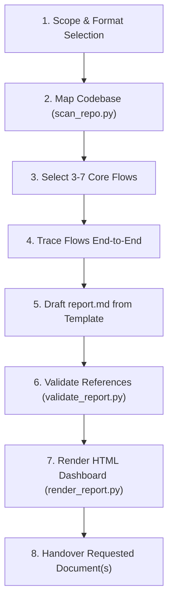

# Code to Business Flow Skill

> Reverse-engineer application source code into human-readable business flows, user journeys, state lifecycles, and evidence-backed business rules.

---

## 📌 Overview

Code reveals **what** happens, but rarely **why**. When onboarding onto an unfamiliar codebase, preparing specifications for stakeholders, or reverse-engineering legacy systems, developers and AI agents often make guesses about business intent.

The **`code-to-business-flow`** skill solves this by enforcing an evidence-backed analysis workflow. Every rule and state transition extracted from the codebase carries a provenance tag (`[FACT]`, `[INFERRED]`, or `[UNKNOWN]`), resulting in a layered report that non-technical stakeholders can follow and software engineers can verify down to the line of code.

---

## 🚀 Key Features

- **Evidence-Based Tracing**: Every statement is grounded in concrete code lines or explicitly marked as an inference or unknown business question.
- **Flexible Output Formats**: Selectable upfront based on stakeholder needs:
  - `report.md`: Layered Markdown report following [`assets/report-template.md`](assets/report-template.md) for version control and PR reviews.
  - `report.html`: Self-contained interactive single-file HTML dashboard with tab navigation, badge styling, and live-rendered, interactive Mermaid diagrams.
  - **Both**: Produces both documents (default when unstated).
- **Interactive Visual Models**: Includes journey maps (`flowchart LR`), decision paths (`flowchart TD`), sequence diagrams (`sequenceDiagram`), and state lifecycles (`stateDiagram-v2`), with built-in **zoom in/out, pan/drag, and reset controls**.
- **Standard Library Tooling**: Bundled Python scripts operate purely on Python 3.8+ standard library—no `pip install` required.
- **Host Safety**: Designed for clean execution inside sandboxed environments without host machine pollution.

---

## 📂 Skill Architecture

```text
skills/code-to-business-flow/
├── SKILL.md                          # Agent instructions, trigger definitions & rules
├── README.md                         # Human-readable documentation & script guide
├── assets/
│   ├── report-template.md            # Structural markdown template for reports
│   └── report-template.html          # HTML shell used by the report renderer
├── references/
│   └── discovery-signals.md          # Guide on where business logic hides in codebases
└── scripts/
    ├── scan_repo.py                  # Entry points and state signal scanner
    ├── validate_report.py            # Line references and structure validator
    └── render_report.py              # Markdown-to-interactive HTML renderer
```

---

## 🔄 The 8-Step Workflow

When an agent activates this skill, it executes the following structured workflow:



1. **Scope & Format Selection**: Define target directory, specific features, report language, and output format preference (Markdown, Interactive HTML, or Both).
2. **Map the Repo**: Execute `scan_repo.py` to identify routes, scheduled tasks, background queues, webhooks, and status models.
3. **Choose Flows**: Select 3 to 7 high-impact flows (state changes, financial impact, handoffs, or headless cron jobs).
4. **Trace End-to-End**: Follow execution paths from trigger to outcome, consulting [`references/discovery-signals.md`](references/discovery-signals.md) to locate buried policy, validation, and database constraints.
5. **Write Report**: Populate `report.md` based on [`assets/report-template.md`](assets/report-template.md) across three distinct layers (Summary, Detailed Flows, Technical Detail).
6. **Validate**: Run `validate_report.py` to confirm that every `path:line` citation exists and that all Mermaid blocks conform to diagram specifications.
7. **Render**: When HTML or Both is requested, run `render_report.py` to compile `report.md` into `report.html` with zoomable/pannable diagrams.
8. **Handover**: Present output file path(s) and highlight unresolved `[UNKNOWN]` questions for business owners.

---

## 🏷️ Evidence Rules

To prevent hallucinations, statements must use one of three explicit tags:

| Tag | Definition | Required Evidence |
|---|---|---|
| `[FACT]` | Directly enforced by the codebase. | Citation formatted as `` `path/to/file.ext:line` `` or `` `path/to/file.ext:10-25` ``. |
| `[INFERRED]` | Suggested by naming conventions, comments, or tests, but not strictly enforced. | Rationale explaining what the inference rests upon. |
| `[UNKNOWN]` | Crucial business context not ascertainable from the codebase. | Expressed as an explicit question for the business owner. |

---

## 📊 Diagram Conventions

- **Summary Journey**: A single high-level `flowchart LR` (maximum 12 nodes) using subgraphs for actor swimlanes.
- **Detailed Flow**: A `flowchart TD` illustrating happy paths alongside error and rejection exits.
- **Complex Interactions**: A `sequenceDiagram` whenever three or more actors, services, or third-party APIs interact.
- **Entity Lifecycles**: A `stateDiagram-v2` illustrating status transitions, trigger events, and acting roles.
- **Syntax Safety**: Node labels must be 5 words or fewer, enclosed in double quotes when containing special punctuation. Never use lowercase `end` as a node ID or label.

---

## 🛠️ Bundled Scripts

All scripts are located in `scripts/` and run using Python 3.8+ standard library:

### 1. `scan_repo.py`
Scans a target codebase for architectural signals, routes, controllers, event listeners, and models.

```bash
python3 skills/code-to-business-flow/scripts/scan_repo.py /path/to/repo --output /tmp/scan.json
```

**Options**:
- `--output FILE`: Output destination (`-` for stdout).
- `--max-per-category N`: Cap items listed per category (default: 25, max 5 per file).
- `--exclude DIR`: Skip additional directories (e.g. `--exclude tests --exclude fixtures`).

### 2. `validate_report.py`
Validates that cited lines exist in the target repository and checks report structure.

```bash
python3 skills/code-to-business-flow/scripts/validate_report.py report.md --root /path/to/repo
```

**Checks**:
- Resolves all `[FACT]` `path:line` references against real files in `--root`.
- Verifies at least three level-2 heading sections.
- Validates Mermaid diagram types and flags common label syntax issues.
- Detects unreplaced `{{placeholder}}` markers.

### 3. `render_report.py`
Compiles `report.md` into an interactive `report.html` file with tabbed navigation and badge styling.

```bash
python3 skills/code-to-business-flow/scripts/render_report.py report.md --output report.html --lang en
```

**Options**:
- `--output FILE`: Destination HTML file (required).
- `--lang en|id`: Language for badge legends and metadata (default: `en`).
- `--mermaid-url URL`: Alternative CDN URL for the Mermaid runtime.

---

## 📋 Compatibility & Requirements

- **Runtime**: Python 3.8+ (standard library only, zero external pip packages).
- **Environment Isolation**: Run all analysis steps and bundled scripts within a sandbox environment (`BypassSandbox: false` or container) whenever available to avoid modifying or polluting the host machine.
- **Viewing HTML Diagrams**: The generated `report.html` loads the Mermaid library from a public CDN; internet access is required when opening the HTML report to render interactive diagrams (fallback displays diagram source). Diagrams include interactive pan & zoom controls (scroll wheel zoom, drag pan, reset button).

