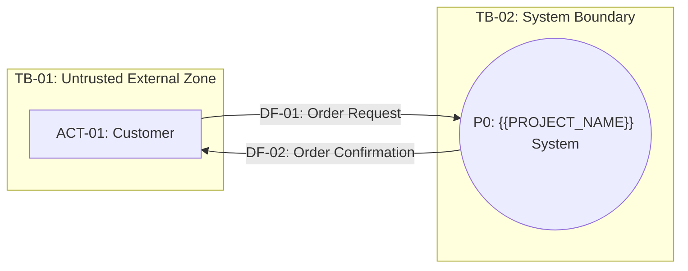
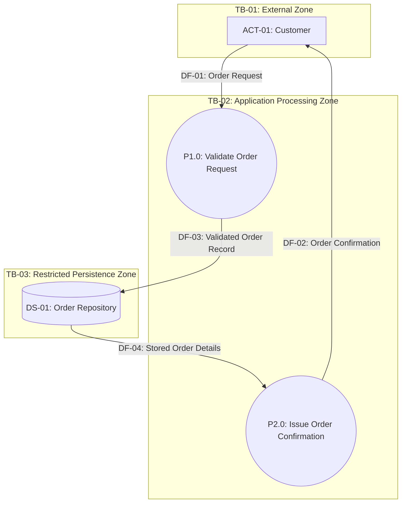

# Data Flow Diagram (DFD) Specification: {{PROJECT_NAME}}

## 1. External Entities Mapping (`ACT-XX`)

| Entity ID | Entity Name | Type | Trust Zone | Inbound Flows (System $\to$ Entity) | Outbound Flows (Entity $\to$ System) |
| :--- | :--- | :--- | :--- | :--- | :--- |
| **ACT-01** | `{{Customer}}` | Human Role | `TB-01: Public` | `DF-02: Order Confirmation` | `DF-01: Order Request` |

---

## 2. Context Diagram (DFD Level 0)

### 2.1 Level 0 Mermaid Graph

### 2.2 Level 0 Boundary Flow Registry (Machine-Validated)

<!-- LINTER_TABLE:L0_FLOWS -->
| Flow ID | Source ID | Source Type | Target ID | Target Type | Payload Name (Noun Phrase) | Crosses TB |
| :--- | :--- | :--- | :--- | :--- | :--- | :--- |
| **DF-01** | `ACT-01` | `EE` | `P0` | `P` | `Order Request` | `TB-01 -> TB-02` |
| **DF-02** | `P0` | `P` | `ACT-01` | `EE` | `Order Confirmation` | `TB-02 -> TB-01` |

---

## 3. DFD Level 1 Decomposition (Functional Grouping by Epic)

### 3.1 Level 1 Master Mermaid Graph ($7 \pm 2$ Processes)

### 3.2 Level 1 Complete Graph Edge Registry (Machine-Validated)

<!-- LINTER_TABLE:L1_FLOWS -->
| Flow ID | Source ID | Source Type | Target ID | Target Type | Payload Name (Noun Phrase) | Mapped Epic |
| :--- | :--- | :--- | :--- | :--- | :--- | :--- |
| **DF-01** | `ACT-01` | `EE` | `P1.0` | `P` | `Order Request` | `EPIC-01` |
| **DF-03** | `P1.0` | `P` | `DS-01` | `DS` | `Validated Order Record` | `EPIC-01` |
| **DF-04** | `DS-01` | `DS` | `P2.0` | `P` | `Stored Order Details` | `EPIC-01` |
| **DF-02** | `P2.0` | `P` | `ACT-01` | `EE` | `Order Confirmation` | `EPIC-01` |

### 3.3 Process Input/Output Sufficiency Check (Grey Hole Prevention)

| Process ID | Process Name (Active Verb + Object) | Inbound Flows | Outbound Flows | Transformation Logic Summary |
| :--- | :--- | :--- | :--- | :--- |
| **P1.0** | `Validate Order Request` | `DF-01` | `DF-03` | Verifies item availability and formats order record. |
| **P2.0** | `Issue Order Confirmation` | `DF-04` | `DF-02` | Generates confirmation receipt from persisted order details. |

---

## 4. Data Dictionary (Payload Specification)

| Flow ID | Payload Name | Data Attributes & Types | Mandatory/Optional | Sensitivity Label |
| :--- | :--- | :--- | :--- | :--- |
| **DF-01** | `Order Request` | `customer_id (String), items_list (Array), total_amount (Decimal)` | Mandatory | `$Confidential, $PII` |
| **DF-02** | `Order Confirmation` | `order_id (String), timestamp (ISO8601), status (Enum)` | Mandatory | `$Internal` |
| **DF-03** | `Validated Order Record` | `order_id (String), customer_id (String), total_amount (Decimal)` | Mandatory | `$Confidential, $PII` |
| **DF-04** | `Stored Order Details` | `order_id (String), timestamp (ISO8601), status (Enum)` | Mandatory | `$Internal` |

---

## 5. Data Store Specification & CRUD Matrix

| Data Store ID | Store Name (Noun Phrase) | Conceptual Entities | CRUD by Process | Sensitivity Label | Encryption & Retention Policy |
| :--- | :--- | :--- | :--- | :--- | :--- |
| **DS-01** | `Order Repository` | Orders, Line Items | `P1.0 (C, U)`, `P2.0 (R)` | `$Confidential, $PII` | AES-256 at rest `[ASSUMPTION]` |

---

## 6. Trust Boundaries & Security Profile (xDECAF & STRIDE)

### 6.1 xDECAF Security Invariants Verification
- [x] **Rule 1 ($PII / $Credentials Storage):** All Data Stores holding $PII or $Credentials (`DS-01`) enforce encryption at rest.
- [x] **Rule 2 (Boundary Crossing):** All flows crossing `TB-01 <-> TB-02` enforce encrypted transport.

### 6.2 STRIDE Threat Matrix (Boundary-Crossing Flows)

| Boundary Flow | Trust Boundary Crossed | STRIDE Threat Category | Vulnerability Mechanism | Mitigation Control & Provenance |
| :--- | :--- | :--- | :--- | :--- |
| **DF-01** (`ACT-01 -> P1.0`) | `TB-01 -> TB-02` | **S, T, ID, DoS, EoP** | Unauthenticated order injection or payload tampering. | Authenticated session token check, TLS 1.3, schema validation `[ASSUMPTION]`. |

---

## 7. Bidirectional Requirements Traceability Matrix

| URS User Story ID | Epic ID | Actor ID | DFD Level 1 Process ID | Data Flows Involved | Data Stores Accessed |
| :--- | :--- | :--- | :--- | :--- | :--- |
| **US-001** | `EPIC-01` | `ACT-01` | `P1.0`, `P2.0` | `DF-01, DF-02, DF-03, DF-04` | `DS-01` |

