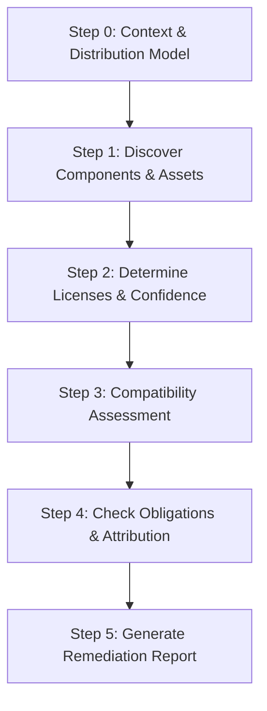

# License Audit Skill

> Audit third-party dependencies, assets, and packages for legal compliance, license compatibility, and IP risks across modern software ecosystems.

---

## 📌 Overview

Open source dependencies, third-party fonts, icon sets, and downloaded assets power modern applications, but they also bring legal obligations and distribution risks. Using a component with a restrictive copyleft license (like GPL or AGPL) in a proprietary closed-source SaaS or distributed binary can create critical intellectual property exposure.

The **`license-audit`** skill provides AI coding agents with a rigorous, evidence-first audit methodology. It inventories locked package versions and non-manifest assets, normalizes licenses to SPDX identifiers, verifies terms against your project's distribution model, and generates actionable remediation reports.

> [!NOTE]
> This skill delivers technical and engineering assessments based on license texts and metadata; it does not replace formal legal counsel.

---

## ⚖️ Core Principles

1. **Evidence Over Memory**: A license claim is only as trustworthy as its verifiable source. No package is cleared based on recollection without explicit citations.
2. **Audit Locked Dependencies**: Inspect exact resolved versions in lockfiles, not loose range specifiers in manifests.
3. **Transparent Uncertainty**: Unknown licenses and missing source disclosures are flagged as blockers or review items rather than assumed safe.
4. **Read-Only by Default**: The audit inspects code without modifying `LICENSE`, manifests, or source files unless explicitly requested.

---

## 📂 Skill Architecture

```text
skills/license-audit/
├── SKILL.md                          # Agent instructions, ecosystem heuristics & workflow
└── README.md                         # Human-readable documentation & reference guide
```

---

## 🔄 The 5-Step Audit Workflow



### Step 0: Context & Scope
Determines the operational context before analyzing dependencies:
- **Project License**: Proprietary, closed-source, permissive open source, or copyleft?
- **Distribution Model**: Internal tool, hosted SaaS/cloud service, distributed binary/app, or public library?
- **Commercial Intent**: Sold commercially or strictly non-commercial?
- **Scope**: Production runtime only, or including build and dev tools?

### Step 1: Discover Components & Assets
Discovers packages and non-manifest assets:
- **Package Manifests & Lockfiles**: Inspects pinned lockfiles across 14+ package ecosystems.
- **Non-Manifest Assets**: Scans for web fonts (`.woff2`, `@font-face`), icon sets (FontAwesome, Lucide), images/media, CDN script tags (`jsdelivr`, `cdnjs`), and embedded base64 `data:` URIs.
- **Vendored Code & Snippets**: Detects copied third-party libraries, git submodules, and code comments citing external repositories or Stack Overflow.

### Step 2: Determine Licenses & Confidence
Extracts and normalizes license identifiers:
- **Confidence Rating**:
  - `Verified`: Read directly from an included license text or authoritative checksummed manifest.
  - `Declared`: Stated only in top-level manifest metadata.
  - `Unverified`: Inferred or unconfirmed; flagged for verification.
- **SPDX Standardization**: Normalizes names to standard identifiers (e.g., `MIT`, `Apache-2.0`, `GPL-3.0-only`, `LGPL-2.1-or-later`).

### Step 3: Assess Compatibility
Evaluates each component against the project's distribution model:

| Category | Examples | Hosted SaaS | Distributed Binary | Open Source |
|---|---|---|---|---|
| **Permissive** | `MIT`, `Apache-2.0`, `BSD-3-Clause` | ✅ OK | ✅ OK (retain notices) | ✅ OK |
| **Weak Copyleft** | `LGPL-3.0-only`, `MPL-2.0`, `EPL-2.0` | ✅ Usually OK | ⚠️ Review linking | ✅ Usually OK |
| **Strong Copyleft**| `GPL-2.0-only`, `GPL-3.0-only` | ✅ Usually OK | ⛔ Blocker | ⚠️ Check compatibility |
| **Network Copyleft**| `AGPL-3.0-only` | ⚠️ High Risk | ⛔ Blocker | ⚠️ Check compatibility |
| **Source-Available**| `BUSL-1.1`, `SSPL-1.0`, `Elastic-2.0` | ⚠️ Often Blocker | ⚠️ Review terms | ⚠️ Review terms |
| **Unknown / None** | Missing or `UNLICENSED` | ⛔ Blocker | ⛔ Blocker | ⛔ Blocker |

### Step 4: Check Obligations & Attribution
Verifies that required conditions are satisfied:
- Inclusion of copyright notices and original license texts.
- Propagation of `NOTICE` files (e.g. for Apache-2.0 dependencies).
- Third-party attribution screens or `THIRD_PARTY_NOTICES` files.

### Step 5: Recommend Remediation
Prioritizes findings into **Blocker**, **High**, **Medium**, and **Low**, providing practical next steps (Clarify, Document, Change version, Replace, Isolate, or Purchase commercial license).

---

## 🌐 Supported Ecosystems

| Ecosystem | Manifests / Lockfiles | Primary License Sources |
|---|---|---|
| **JavaScript / TypeScript** | `package.json`, `package-lock.json`, `yarn.lock`, `pnpm-lock.yaml` | `node_modules/<pkg>/LICENSE*`, package metadata |
| **Python** | `pyproject.toml`, `requirements.txt`, `poetry.lock`, `Pipfile.lock` | `*.dist-info/METADATA`, site-packages license files |
| **PHP** | `composer.json`, `composer.lock` | `vendor/<pkg>/LICENSE*`, `composer.lock` license fields |
| **Go** | `go.mod`, `go.sum` | `vendor/` or module cache licenses |
| **Rust** | `Cargo.toml`, `Cargo.lock` | Crate manifests and crate license files |
| **JVM (Java / Kotlin)** | `pom.xml`, `build.gradle(.kts)`, `gradle.lockfile` | Artifact `.pom` `<licenses>`, embedded JAR metadata |
| **.NET / C#** | `*.csproj`, `packages.lock.json` | `.nuspec` license records in NuGet cache |
| **Dart / Flutter** | `pubspec.yaml`, `pubspec.lock` | Pub cache license files |
| **Containers & Cloud** | `Dockerfile`, Compose files, Terraform (`*.tf`), Helm charts | Base images, installed OS packages, provider licenses |

---

## 📄 Output Artifact

The skill outputs a structured report (typically saved as `LICENSE-AUDIT.md`) containing:
1. **Executive Summary**: Issue count breakdown by severity and shipping readiness.
2. **Context & Assumptions**: Deployment model and licensing assumptions.
3. **Coverage Matrix**: Clear listing of inspected folders vs. uninspected services.
4. **Inventory Table**: Full list of dependencies with versions, scope, SPDX license, and confidence.
5. **Detailed Findings**: Specific risks categorized by severity.
6. **Remediation Plan**: Actionable steps, estimated effort, and alternative packages.

---

## 📋 Compatibility

- **Offline-First**: Fully functional without internet connectivity by parsing local files, lockfiles, and installed package directories.
- Web access (when permitted) is used strictly to verify unknown licenses or query upstream registries.

