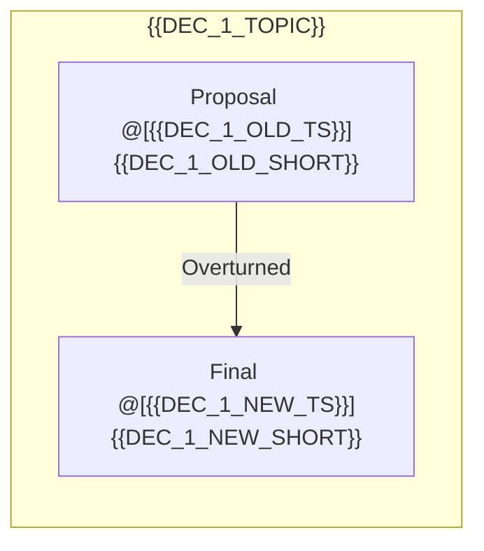

# Meeting Intelligence & Action Plan: {{MEETING_TITLE}}

* **Meeting Anchor Date ($T_{\text{meeting}}$)**: `{{MEETING_DATE_ISO}}`
* **Recording Duration**: `{{TOTAL_DURATION}}`
* **Verified Speaker Roster**: {{SPEAKER_ROSTER}}
* **Source File**: `{{SOURCE_FILE}}`

---

## 1. Executive Summary (3–5 Sentences)

{{EXECUTIVE_SUMMARY}}

---

## 2. Decision Evolution Log & Tension Mapping

Traces proposals, debates, and state overwrites (`[OVERTURNED]` $\rightarrow$ `[ACTIVE]`) across the meeting timeline:

| Decision ID | Topic / Entity | Lifecycle State | Timestamp Span | Resolution / State Value | Rationale & Verbatim Context |
| :--- | :--- | :--- | :--- | :--- | :--- |
| `DEC-01` | {{DEC_1_TOPIC}} | `[OVERTURNED]` | `@[{{DEC_1_OLD_TS}} -> {{DEC_1_NEW_TS}}]` | {{DEC_1_OLD_VAL}} | {{DEC_1_OLD_REASON}} |
| `DEC-01` | {{DEC_1_TOPIC}} | `[ACTIVE]` | `@[{{DEC_1_NEW_TS}}]` | **{{DEC_1_NEW_VAL}}** | "{{DEC_1_QUOTE}}" |



---

## 3. Committed Action Plan & RACI Matrix ([ACTIVE])

All tasks below have passed coreference resolution, speaker grounding, and temporal normalization:

| Task ID | Task Name (Self-Contained) | Assignee (R) | RACI (A/C/I) | Priority | Due Date (ISO) | State & Timestamp | Definition of Done (DoD) |
| :--- | :--- | :--- | :--- | :--- | :--- | :--- | :--- |
| `ACT-01` | {{TASK_1_NAME}} | **{{TASK_1_ASSIGNEE}}** | A: {{TASK_1_ACC}} | `{{TASK_1_PRIO}}` | `{{TASK_1_DUE}}` | `[ACTIVE]` `@[{{TASK_1_TS}}]` | {{TASK_1_DOD}} |

---

## 4. Human-in-the-Loop Triage Queue ([NEEDS-REVIEW])

Items requiring manager/team confirmation due to missing owner (Unassigned), unconfirmed deadline (TBD), or implicit commitment:

| Task ID | Proposed Task | Missing / Ambiguous Field | Timestamp Span | Verbatim Utterance | Clarification Question for Team |
| :--- | :--- | :--- | :--- | :--- | :--- |
| `TRI-01` | {{TRI_1_NAME}} | `{{TRI_1_MISSING}}` | `[NEEDS-REVIEW]` `@[{{TRI_1_TS}}]` | "{{TRI_1_QUOTE}}" | {{TRI_1_QUESTION}} |

---

## 5. Cognitive-Friendly Follow-Up Schedule (auto-scheduler)

Incorporates 15-minute cognitive transition buffers and preserves morning hyperfocus blocks:

- **Follow-Up Session**: {{FOLLOWUP_TITLE}} `[ACTIVE]` `@[{{FOLLOWUP_TS}}]`
- **Proposed Slot (ISO)**: {{FOLLOWUP_START_ISO}} to {{FOLLOWUP_END_ISO}} (+15m Cognitive Buffer until {{FOLLOWUP_BUFFER_END}})
- **Attendees**: {{FOLLOWUP_ATTENDEES}}
- **3-Point Agenda & Pre-Read**:
  1. {{AGENDA_ITEM_1}}
  2. {{AGENDA_ITEM_2}}
  3. {{AGENDA_ITEM_3}}

---

## 6. Constrained Action Item Schema (JSON Payload)

```json
[
  {
    "task_id": "ACT-01",
    "task_name": "{{TASK_1_NAME}}",
    "assignee": "{{TASK_1_ASSIGNEE}}",
    "assignee_canonical_id": "{{TASK_1_CANONICAL_ID}}",
    "due_date_iso": "{{TASK_1_DUE}}",
    "status": "Todo",
    "lifecycle_state": "ACTIVE",
    "priority": "{{TASK_1_PRIO}}",
    "definition_of_done": "{{TASK_1_DOD}}",
    "context_timestamp": "[{{TASK_1_TS}}]",
    "verbatim_source_quote": "{{TASK_1_QUOTE}}",
    "confidence_score": 0.95
  }
]
```

