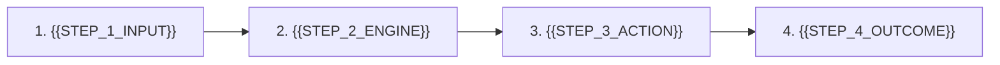

# {{COMPANY_NAME}}
## Slide 1 — Purpose: {{DECLARATIVE_ONE_LINER}}

* **Category**: {{SECTOR_CATEGORY}} `[VERIFIED]`
* **Target ICP**: {{TARGET_ICP}} `[VERIFIED]`
* **Stage & Contact**: {{STAGE}} | {{CONTACT_EMAIL}} `[FOUNDER-INPUT]`

<!-- _notes:
Welcome. We are {{COMPANY_NAME}}. In plain terms, {{DECLARATIVE_ONE_LINER}}. Today we will show how we solve a critical bottleneck for {{TARGET_ICP}} and our path to building a category leader.
-->

---

## Slide 2 — Problem: {{PROBLEM_ACTION_HEADLINE}}

* **Pain #1 (Broken Status Quo)**: {{PAIN_POINT_1}} `[VERIFIED]`
* **Pain #2 (Economic Loss)**: {{PAIN_POINT_2}} `[BOTTOMS-UP]`
* **Pain #3 (Incumbent Failure)**: {{PAIN_POINT_3}} `[VERIFIED]`

> **Cost of Inaction**: {{QUANTIFIED_PAIN_METRIC}} `[BOTTOMS-UP]`

<!-- _notes:
Here is why this is a hair-on-fire problem. Right now, {{TARGET_ICP}} rely on broken manual workflows. This is not a minor inconvenience—it directly costs them time and margin every single month.
-->

---

## Slide 3 — Solution: {{SOLUTION_ACTION_HEADLINE}}

* **Outcome #1 (Fixes Pain #1)**: {{SOLUTION_OUTCOME_1}} `[VERIFIED]`
* **Outcome #2 (Fixes Pain #2)**: {{SOLUTION_OUTCOME_2}} `[BOTTOMS-UP]`
* **Outcome #3 (Fixes Pain #3)**: {{SOLUTION_OUTCOME_3}} `[VERIFIED]`

> **Value Proposition**: {{CORE_VALUE_UNLOCK}} `[VERIFIED]`

<!-- _notes:
Our solution directly mirrors those three pain points. Instead of manual overhead, we deliver measurable speed and cost reduction from day one without ripping out their existing stack.
-->

---

## Slide 4 — Why Now: {{WHY_NOW_ACTION_HEADLINE}}

* **Technology Inflection**: {{TECH_CATALYST}} `[VERIFIED]`
* **Market / Regulatory Shift**: {{MARKET_CATALYST}} `[VERIFIED]`
* **Behavioral Trigger**: {{BEHAVIOR_CATALYST}} `[VERIFIED]`

<!-- _notes:
Why couldn't this be built three years ago? The convergence of {{TECH_CATALYST}} and shifting buyer behavior created an inflection point that makes rapid adoption possible right now.
-->

---

## Slide 5 — Market Size: {{MARKET_ACTION_HEADLINE}}

| Segment | Target Customer Scope | Bottoms-Up Formula (`ICP × ACV`) | Annual Value |
| :--- | :--- | :--- | :--- |
| **TAM** | {{TAM_SCOPE}} | {{TAM_FORMULA}} | {{TAM_VALUE}} `[BOTTOMS-UP]` |
| **SAM** | {{SAM_SCOPE}} | {{SAM_FORMULA}} | {{SAM_VALUE}} `[BOTTOMS-UP]` |
| **SOM (Yr 3)** | {{SOM_SCOPE}} | {{SOM_FORMULA}} | {{SOM_VALUE}} `[BOTTOMS-UP]` |

<!-- _notes:
We do not rely on top-down consulting estimates. Looking strictly bottoms-up: multiplying our verified target customer count by our annual contract value yields a highly actionable SOM over the next 36 months.
-->

---

## Slide 6 — Product Workflow: {{PRODUCT_ACTION_HEADLINE}}

* **Zero-Friction Onboarding**: {{PRODUCT_HIGHLIGHT_1}} `[VERIFIED]`
* **Core Automation**: {{PRODUCT_HIGHLIGHT_2}} `[VERIFIED]`

<!-- _notes:
Here is how our engine works end-to-end. We ingest raw data seamlessly, execute our core proprietary workflow logic, and deliver verified actionable outputs without requiring complex onboarding.
-->

---

## Slide 7 — Traction: {{TRACTION_ACTION_HEADLINE}}

* **Current Momentum**: {{TRACTION_METRIC_1}} `[FOUNDER-INPUT]`
* **Validation / Pilots**: {{TRACTION_METRIC_2}} `[FOUNDER-INPUT]`
* **Pipeline & Velocity**: {{TRACTION_METRIC_3}} `[FOUNDER-INPUT]`

<!-- _notes:
Our early traction demonstrates real pull from the market. We have validating pilot feedback, concrete usage velocity, and a growing enterprise pipeline backing our core hypothesis.
-->

---

## Slide 8 — Business Model: {{BIZ_MODEL_ACTION_HEADLINE}}

* **Revenue Model**: {{REVENUE_MODEL_DESC}} `[VERIFIED]`
* **Pricing Tiers**: {{PRICING_TIERS_DESC}} `[BOTTOMS-UP]`
* **Target Unit Economics**: Gross Margin {{GROSS_MARGIN}} | LTV:CAC {{LTV_CAC}} | Payback {{PAYBACK_MONTHS}} `[BOTTOMS-UP]`

<!-- _notes:
Our business model is engineered for rapid time-to-value and sustainable expansion. Clear pricing tiers deliver attractive gross margins with predictable payback periods.
-->

---

## Slide 9 — Competition & Moat: {{MOAT_ACTION_HEADLINE}}

| Capability / Defensibility | Status Quo (Manual) | Legacy Incumbents | **{{COMPANY_NAME}}** |
| :--- | :--- | :--- | :--- |
| **Setup Speed** | Slow / Error-Prone | Months of Consulting | **Minutes** `[VERIFIED]` |
| **Unit Cost** | High Labor Cost | Expensive Seats | **ROI-Positive** `[BOTTOMS-UP]` |
| **Core Moat** | None | Legacy Lock-in | **{{PRIMARY_MOAT}}** `[VERIFIED]` |

<!-- _notes:
We don't operate in a vacuum—our real rival today is the manual status quo. While legacy vendors offer slow, heavy implementations, our defensible advantage lies in our deep workflow integration.
-->

---

## Slide 10 — Team: {{TEAM_ACTION_HEADLINE}}

* **{{FOUNDER_1_ROLE}}**: {{FOUNDER_1_BIO}} `[FOUNDER-INPUT]`
* **{{FOUNDER_2_ROLE}}**: {{FOUNDER_2_BIO}} `[FOUNDER-INPUT]`
* **Domain Unfair Advantage**: {{TEAM_EDGE}} `[FOUNDER-INPUT]`

<!-- _notes:
Our founding team combines deep engineering execution with direct domain insight. We have built and scaled systems in this exact vertical before, giving us unmatched execution velocity.
-->

---

## Slide 11 — Financials: {{FINANCIAL_ACTION_HEADLINE}}

| Metric | Year 1 | Year 2 | Year 3 | Provenance |
| :--- | :--- | :--- | :--- | :--- |
| **Active Customers** | {{Y1_CUST}} | {{Y2_CUST}} | {{Y3_CUST}} | `[BOTTOMS-UP]` |
| **ARR** | {{Y1_ARR}} | {{Y2_ARR}} | {{Y3_ARR}} | `[BOTTOMS-UP]` |
| **Gross Margin %** | {{Y1_GM}} | {{Y2_GM}} | {{Y3_GM}} | `[BOTTOMS-UP]` |
| **Net Burn / Mo** | {{Y1_BURN}} | {{Y2_BURN}} | {{Y3_BURN}} | `[FOUNDER-INPUT]` |

<!-- _notes:
Our financial projections are rooted in unit economics, customer acquisition milestones, and disciplined burn management rather than arbitrary growth assumptions.
-->

---

## Slide 12 — The Ask: {{ASK_ACTION_HEADLINE}}

* **Fundraise Target**: Raising {{RAISE_AMOUNT}} ({{ROUND_TYPE}}) for {{RUNWAY_MONTHS}} runway `[FOUNDER-INPUT]`
* **Use of Funds**: {{USE_OF_FUNDS_SPLIT}} `[FOUNDER-INPUT]`
* **18-Month Unlock Milestones**: Reach {{MILESTONE_ARR}} and {{MILESTONE_PRODUCT}} `[FOUNDER-INPUT]`

<!-- _notes:
We are raising our target round to accelerate engineering, execute our go-to-market playbook, and hit critical ARR and product milestones over the next 18 months. Thank you.
-->

