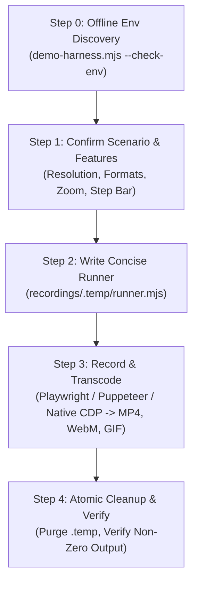

# Record Web Demo Skill

> Automated screen recording for web applications using whichever browser runtime and browser binary are already installed (Playwright, Puppeteer, or zero-dependency Chromium CDP), with humanized pacing, dynamic cursor simulation, and multi-format transcoding (MP4, WebM, GIF).

---

## 📌 Overview

Automated browser tests execute at machine speed: mouse coordinates teleport instantly, forms fill in milliseconds, and the operating system cursor is invisible in headless mode. While great for CI assertions, raw test runs are hard to follow in product demos, changelogs, and GitHub READMEs.

The **`record-web-demo`** skill provides a reusable, offline-first runtime (`scripts/demo-harness.mjs`) that automatically discovers installed automation packages, browser binaries, and `ffmpeg` on the host without forcing network downloads or locking into a single browser vendor. It injects crisp Tabler vector cursors with click ripples, moves along eased curves, optionally zooms and narrates steps, speed-ramps slow waits, and exports clean MP4, WebM, or GIF outputs.

---

## ✨ Key Features

- **Multi-Engine & Bring-Your-Own-Browser Discovery**:
  - Automatically detects and reuses Node `playwright` / `playwright-core`, `puppeteer` / `puppeteer-core`, or falls back to a built-in zero-dependency **Chromium CDP** driver (`Page.startScreencast` + `ffmpeg`).
  - Scans `DEMO_BROWSER_PATH`, `CHROME_BIN`, Playwright caches (`PLAYWRIGHT_BROWSERS_PATH`, `.venv*/ms-playwright`, `~/.cache/ms-playwright`), and system browsers (`google-chrome`, `chromium`, `brave-browser`, `microsoft-edge`, `firefox`).
  - Discovers `ffmpeg` on `PATH` or inside Playwright binary caches.
- **Dynamic Vector Cursors & Click Ripples**: Injects MIT-licensed Tabler SVG cursors (`default`, `pointer`, `text`) on `document.documentElement` plus expanding `#demo-click-ripple` highlights on `mousedown` so clicks remain readable even in 15fps GIFs.
- **Humanized Interaction & Speed Ramping (Default: Active)**: Moves cursors along cubic ease-in-out trajectories, clears pre-filled fields before typing (`85ms`/char short, `42ms`/char `> 15` chars), and accelerates `withSpeedRamp()` segments via FFmpeg `trim`/`setpts`/`concat`.
- **Auto-Zoom & Pan on Hotspots (Opt-in, Default: Off)**: Smoothly zooms onto compact inputs or Playwright locators (`demo.zoomTo(target, 1.65)`) clamped inside the app stage, then resets back (`demo.resetZoom()`).
- **Dual-Mode Step Callouts (Opt-in, Default: Off)**:
  1. **`static-bar` (Recommended)**: Fixed `52px` bottom bar (`#0f172a`) with `~0.92x` scaled stage above it so badges never cover controls.
  2. **`floating`**: Full `1.0x` stage with an auto-dodging pill badge across 4 viewport anchors.
- **Atomic Staging & Multi-Format Export**: Keeps transient files in `recordings/.temp/`, transcodes to H.264 `+faststart` MP4, WebM, or two-pass Bayer-dithered GIF, and removes `.temp/` in `finally`.

---

## 📂 Skill Architecture

```text
skills/record-web-demo/
├── SKILL.md                    # Core agent workflow and API reference
├── README.md                   # Human-readable guide & examples
├── scripts/
│   └── demo-harness.mjs        # Offline discovery, multi-engine runner & FFmpeg transcoder
└── tests/
    └── test_harness.mjs        # Node built-in unit & end-to-end tests
```

---

## 🔄 Workflow



### Step 0: Check Available Tools Offline

```bash
node skills/record-web-demo/scripts/demo-harness.mjs --check-env
```

Inspects Node.js, installed drivers, cached/system browsers, and `ffmpeg` in `<50ms` without hitting the network.

### Step 1: Choose Parameters & Optional Visual Aids

- **Resolution**: `1280x720` (default) or `1920x1080`.
- **Formats**: `.mp4`, `.gif`, `.webm`, or an array exporting multiple formats from a single recording.
- **Step Narration Layout** (when enabled):

```text
[A] Static Bottom Bar (stepMode: 'static-bar' — Recommended)
+---------------------------------------------------+
|  +---------------------------------------------+  |
|  |         Web Application Stage (~0.92x)      |  |
|  |       Zero overlap with page controls       |  |
|  +---------------------------------------------+  |
+---------------------------------------------------+
|          [ Step 1: Sign in with account ]         | <- Fixed 52px bottom bar
+---------------------------------------------------+

[B] Floating Pill (stepMode: 'floating')
+---------------------------------------------------+
|                                                   |
|            Web Application Stage (1.0x)           |
|                                                   |
|         ( Step 1: Sign in with account )          | <- Auto-dodges cursor & buttons
+---------------------------------------------------+
```

### Step 2–3: Run a Declarative Demo Script

Write a minimal `recordings/.temp/runner.mjs` importing `recordDemo`:

```javascript
import { recordDemo } from '../skills/record-web-demo/scripts/demo-harness.mjs';

await recordDemo({
  url: 'http://localhost:3000',
  output: ['recordings/login-flow.mp4', 'recordings/login-flow.gif'],
  viewport: { width: 1280, height: 720 },
  stepMode: 'static-bar',
}, async (demo) => {
  await demo.showStep('Step 1: Sign in with your account');
  await demo.zoomTo('#login-card', 1.5);
  await demo.humanType('#email', 'alex@example.com');
  await demo.humanType('#password', 'correct-horse-battery');
  await demo.resetZoom();
  await demo.withSpeedRamp(() => demo.moveAndClick('button[type="submit"]'));
  await demo.pause(900);
});
```

Run it with:

```bash
node recordings/.temp/runner.mjs
```

To re-transcode or apply speed ramps to an existing capture directly:

```bash
node skills/record-web-demo/scripts/demo-harness.mjs --transcode raw.webm \
  --output recordings/flow.mp4 --output recordings/flow.gif \
  --segments '[{"start":1.2,"end":3.8,"speed":1.75}]'
```

---

## 🧪 Running Tests

```bash
node --test skills/record-web-demo/tests/test_harness.mjs
```

---

## 🛠️ Requirements & Prerequisites

| Requirement | Purpose | Notes |
|---|---|---|
| **Node.js 18+** | Harness & runner runtime | Uses Node built-ins only (zero external npm deps required by harness) |
| **Any Browser + Driver** | Headless page capture | Reuses installed Playwright, Puppeteer, or zero-dep Native CDP with Chrome/Edge/Brave/Chromium |
| **FFmpeg** | MP4, GIF, speed ramping, & CDP encoding | Uses `PATH` or Playwright-cached `ffmpeg`; optional if only Playwright `.webm` is needed |

---

## 📄 License

Distributed under the [MIT License](../../LICENSE).
Dynamic vector cursors are adapted from [Tabler Icons](https://github.com/tabler/tabler-icons) (MIT License).
