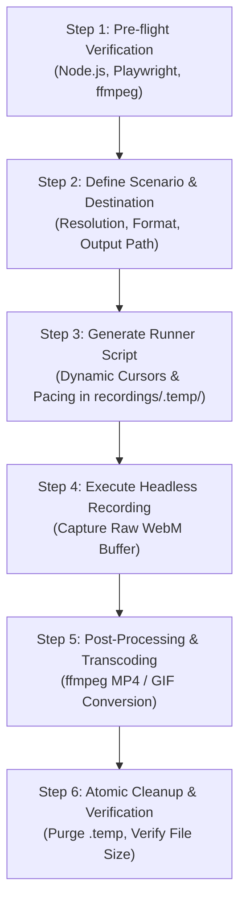

# Record Web Demo Skill

> Automated screen recording for web applications using Playwright with humanized pacing, dynamic cursor simulation, and multi-format transcoding (MP4, WebM, GIF).

---

## 📌 Overview

Automated browser tests execute at machine speed: mouse coordinates teleport instantly, forms fill in milliseconds, and the operating system cursor is completely invisible in headless mode. While efficient for CI tests, these recordings are disorienting and unwatchable for human product demos, visual documentation, release changelogs, and GitHub READMEs.

The **`record-web-demo`** skill gives AI coding agents a deterministic, polished workflow to record web application walkthroughs. It injects dynamic, high-contrast vector cursors, applies humanized pacing with natural cursor trajectories, stages execution inside an isolated temporary directory, and transcodes raw captures into production-ready MP4 or GIF formats.

---

## ✨ Key Features

- **Dynamic Vector Cursors**: Injects MIT-licensed Tabler vector cursors into the browser DOM (`document.documentElement`) that dynamically switch between standard arrow, interactive pointer hand, and text I-beam with calibrated hotspots and click feedback (`scale(0.85)`).
- **Dual-Tone High Contrast**: Cursors feature white fills with dark borders and drop shadows, ensuring clear visibility across light, dark, and mixed application themes.
- **Speed Ramping (Default: Active)**: Automatically accelerates long text typing (`1.5x–2x` via `42ms` character delay) and compresses slow loading spinners/network waits via FFmpeg `setpts` filters while keeping key UI transitions (modals, theme changes) at normal `1x` speed.
- **Auto-Zoom & Pan on Hotspots (Opt-in, Default: Off)**: Smoothly zooms (`1.65x`) and pans the viewport toward compact inputs, password fields, or theme toggles so small controls remain legible on mobile screens, then zooms back out (`1x`) for full-layout navigation without exposing blank margins or scaling the cursor/badges.
- **Step Callout / Visual Narration (Opt-in, Default: Off)**: Supports two user-selectable layout styles:
  1. **`static-bar` (Recommended)**: Reserves a dedicated `52px` static footer bar (`#0f172a`) at the bottom while scaling the web application stage to `~0.92x` above it so the badge stays completely stationary without overlapping page controls.
  2. **`floating`**: Keeps the web page at full `1.0x` scale and renders a floating semi-transparent pill badge that automatically dodges buttons and cursor proximity.
- **Humanized Interaction Pacing**: Simulates realistic human interactions using stepped cursor curves (`steps: 25`), adaptive typing delays (`85ms` short / `42ms` long), and settle pauses (`800ms`) after state transitions or modals.
- **Isolated Atomic Staging**: Colocates transient runner scripts and raw video buffers inside `recordings/.temp/`, ensuring a clean workspace that purges completely in a single `rm -rf` command.
- **Multi-Format Export Pipeline**:
  - **Native WebM**: Direct Playwright video output without transcoding overhead.
  - **Optimized MP4**: H.264 video with `yuv420p` pixel format and `+faststart` flags for universal browser and mobile playback.
  - **Two-Pass Palettegen GIF**: High-fidelity animated GIFs utilizing Bayer dithering to eliminate color banding while minimizing file size for GitHub READMEs.
- **Headless-First Reliability**: Records full-fidelity video in headless environments without requiring a physical monitor or virtual framebuffer (Xvfb).

---

## 📂 Skill Architecture

```text
skills/record-web-demo/
├── SKILL.md                          # Core agent instructions, cursor SVGs & execution workflow
└── README.md                         # Human-readable documentation & reference guide
```

---

## 🔄 The 6-Step Recording Workflow



### Step 1: Pre-flight Verification
Checks necessary runtime dependencies:
- Node.js environment (`node -v`)
- Playwright runner & Chromium browser (`npx -y playwright install chromium`)
- FFmpeg availability for transcoding (`ffmpeg -version`)

### Step 2: Define Scenario & Parameters
Establishes recording parameters and confirms optional features before generating code:
- **Target URL**: Dev server (e.g. `http://localhost:3000`) or production deployment.
- **Dimensions**: 1280x720 (720p 16:9 standard for READMEs) or 1920x1080 (1080p).
- **Target Format**: WebM, MP4, or GIF.
- **Visual & Timing Enhancements**:
  - **Speed Ramping** (**Default: Active**): Adaptive typing (`1.5x–2x` for long text) and FFmpeg timeline acceleration for slow loading spinners.
  - **Auto-Zoom & Pan** (**Default: Off** — ask user whether to enable): Smooth camera zoom onto compact inputs and toggles.
  - **Step Callout / Visual Narration** (**Default: Off** — ask user whether to enable and show visual comparison between `[A] Static Bottom Bar` and `[B] Floating Badge`):
    ```text
    [A] Static Bottom Bar (mode: 'static-bar' — Recommended)
    +---------------------------------------------------+
    |  +---------------------------------------------+  |
    |  |         Halaman Web Demo (Scale ~0.92x)     |  |
    |  |       Bebas tumpang tindih dengan tombol    |  |
    |  +---------------------------------------------+  |
    +---------------------------------------------------+
    |         [ Langkah 1: Masuk dengan Akun ]          | <- Bar Statis 52px (Posisi Tetap)
    +---------------------------------------------------+

    [B] Floating Badge (mode: 'floating')
    +---------------------------------------------------+
    |                                                   |
    |            Halaman Web Demo (Full 1.0x)           |
    |                                                   |
    |         ( Langkah 1: Masuk dengan Akun )          | <- Pill Melayang (Auto-Dodge jika ada tombol)
    +---------------------------------------------------+
    ```
- **Output Destination**: Standardized under `recordings/<scenario-name>.<ext>` (avoids generic `demo.mp4` collisions).

### Step 3: Script Generation with Dynamic Vector Cursors & Helpers
Generates a self-contained runner script directly inside `recordings/.temp/runner.mjs`. Injects adaptive SVG cursors and helpers:
- **Default Arrow**: Calibrated at hotspot `(-4px, -4px)`.
- **Pointer Hand**: Automatically triggered when hovering over `button`, `a`, `[role="button"]`, or elements with `cursor: pointer`.
- **Text I-Beam**: Automatically triggered over inputs, textareas, and contenteditable elements.
- **Click Feedback**: Scales cursor to `0.85` on `mousedown` and restores to `1.0` on `mouseup`.
- **Speed Ramping Helpers**: `humanType()` (accelerates inputs > 15 chars to `42ms`) and `withSpeedRamp()` (tracks slow loading intervals for FFmpeg acceleration).
- **Optional Camera & Callout Helpers**: `zoomTo()` / `resetZoom()` (clamped viewport pan/zoom on `document.body`) and `showStep()` / `hideStep()` (floating badge mounted on `document.documentElement`).

### Step 4: Execute Recording
Runs the headless script via Node.js, capturing the raw WebM buffer and any `FAST_SEGMENTS` metadata:
```bash
node recordings/.temp/runner.mjs
```

### Step 5: Post-Processing, Speed Ramping & Transcoding
Converts the raw WebM buffer to the requested target format (and applies `trim` + `setpts` speed ramping if `FAST_SEGMENTS` were recorded):

- **Web-Optimized MP4**:
  ```bash
  ffmpeg -y -i recordings/.temp/<raw>.webm -c:v libx264 -pix_fmt yuv420p -movflags +faststart recordings/<scenario-name>.mp4
  ```

- **Timeline Speed Ramping MP4 (1.75x on loading segments)**:
  ```bash
  ffmpeg -y -i recordings/.temp/<raw>.webm -filter_complex \
    "[0:v]trim=0:3.0,setpts=PTS-STARTPTS[v0]; \
     [0:v]trim=3.0:6.5,setpts=(PTS-STARTPTS)/1.75[v1]; \
     [0:v]trim=6.5,setpts=PTS-STARTPTS[v2]; \
     [v0][v1][v2]concat=n=3:v=1:a=0[outv]" \
    -map "[outv]" -c:v libx264 -pix_fmt yuv420p -movflags +faststart recordings/<scenario-name>.mp4
  ```

- **Optimized Two-Pass GIF**:
  ```bash
  ffmpeg -y -i recordings/.temp/<raw>.webm -filter_complex "[0:v] fps=15,scale=1280:-1:flags=lanczos,split [a][b];[a] palettegen=stats_mode=diff [p];[b][p] paletteuse=dither=bayer:bayer_scale=3" recordings/<scenario-name>.gif
  ```

### Step 6: Atomic Cleanup & Delivery
Purges the staging folder completely to leave zero transient artifacts:
```bash
rm -rf recordings/.temp
```
Verifies output file size and delivers the relative/absolute path to the user.

---

## 🛠️ Requirements & Prerequisites

| Requirement | Purpose | Recommended Version |
|---|---|---|
| **Node.js** | Script execution runtime | Node.js 18+ (LTS) |
| **Playwright** | Headless browser automation & video recording | `@playwright/test` or `playwright` |
| **Chromium** | Browser binary | Installed via `npx playwright install chromium` |
| **FFmpeg** | Video transcoding to MP4 and optimized GIF | 4.x / 5.x / 6.x (optional for native WebM) |

---

## 💡 Best Practices & Gotchas

- **Video Buffer Flush**: Playwright writes video frames asynchronously. Always await `context.close()` and `browser.close()` before moving or converting video files, otherwise files will be 0 bytes.
- **Overlay Mounting & Static Step Bar**: Append `#demo-cursor` and `#demo-step-bar` to `document.documentElement` (`<html>`) while applying CSS stage scaling (`~0.92x` base stage or `1.65x` hotspot zoom) to `document.body`. Persist cursor and step state in `sessionStorage` (`__demoCursor`, `__demoStep`, `__demoStepBar`) so page reloads never reset the cursor to `(0, 0)` or drop the bottom bar, and call `showStep()` **before** `zoomTo()` / `moveAndClick()`.
- **Viewport Synchronization**: Always match `viewport` and `recordVideo.size` in `browser.newContext()` to identical dimensions (e.g. `1280x720`) to prevent black borders or distortion.
- **Dynamic Selectors vs. Hardcoded Sleep**: Use `waitForSelector` or `waitForLoadState('networkidle')` before initiating interactions rather than arbitrary short sleeps.
- **Zero Directory Pollution**: Never place temporary scripts in root or create separate `scripts/` or `tmp/` folders in the target project. Keep transient assets confined to `recordings/.temp/`.
- **Git Hygiene**: Add `recordings/.temp/` and `recordings/` to `.gitignore` to avoid checking large video binaries into version control.

---

## 📄 License

This skill is distributed under the [MIT License](../../LICENSE).
Dynamic cursors are based on [Tabler Icons](https://github.com/tabler/tabler-icons) under the MIT License.
