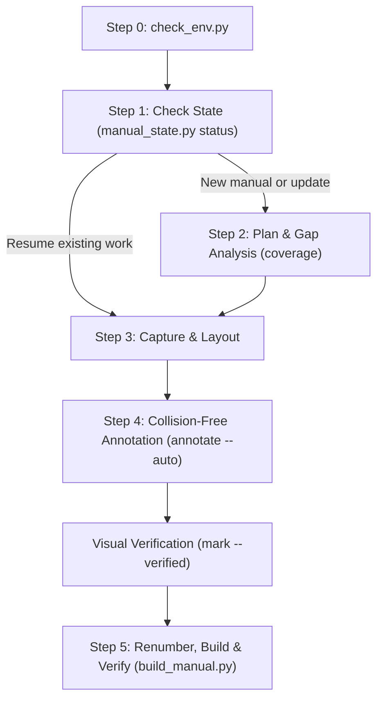

# User Manual Generator Skill

> Generate end-user manual books (user guides / panduan pengguna) for web and desktop applications with working Table of Contents hyperlinks, high-DPI auto-captured screenshots, collision-free arrow annotations, chapter-based figure citations, and page-numbered outputs in Markdown (`.md`), Microsoft Word (`.docx`), and official PDF (`.pdf`).

---

## 📌 Overview

Creating and updating user manuals is traditionally tedious: screenshots quickly become outdated, arrows and badges obscure text labels, Word table-of-contents links break, and page numbers get misaligned whenever new sections are inserted.

The **`user-manual-generator`** skill gives AI coding agents a structured, deterministic toolchain to create, maintain, and update professional user manual books. It features:
- **Sandbox-First Execution**: Works inside standard agent sandboxes with isolated virtual environment support.
- **Task Continuation & Resume**: Tracks milestones in `manual_progress.json` and tells the agent the exact next command to run if interrupted.
- **Feature Gap Analysis**: Compares codebase routes, pages, and menus against the manual to pinpoint missing, documented, or stale features.
- **High-DPI Capture & Layout Mapping**: Automatically captures Retina-grade (`deviceScaleFactor=2`) screenshots (single URL or batch `--spec`) and extracts element coordinates into layout sidecars.
- **Dual-Engine Collision-Free Arrow Annotations**: Intelligently routes arrows to element boundaries while placing tail badges in clear whitespace without occluding on-screen text (prefers PyCairo vector rendering for PNGs, with Pillow fallback).
- **Standards-Compliant Word & PDF Output**: Uses a 100% Python stdlib ECMA-376 OpenXML builder (`stdlib-oxml`) producing clickable Table of Contents hyperlinks, dot leader tabs aligned to printable margins, self-contained embedded media (`word/media/`), Roman front-matter numerals, clean blank headers, standard 1.0-inch margins, styled callout blockquotes, dynamic `PAGEREF` page numbers, and official `.pdf` export.

---

## 📂 Skill Architecture

```text
skills/user-manual-generator/
├── SKILL.md                          # Core agent instructions and workflow
├── README.md                         # Human-readable documentation
├── references/
│   ├── copywriting-and-layout.md     # Copywriting guidelines, figure captions, and spec schema
│   ├── maintenance-workflow.md       # Task continuation, feature discovery, and renumbering
│   └── security-policy.md            # Security constraints, path validation, and subprocess safety
├── scripts/
│   ├── check_env.py                  # Environment readiness and dependency checker
│   ├── manual_state.py               # State manager, resume tracker, coverage, and renumbering
│   ├── capture_and_annotate.py       # High-DPI capture, grid overlay, and collision-free annotator
│   ├── annotate_cairo.py             # Direct PyCairo vector arrow, badge, and dashed box engine
│   ├── embed_images.py               # OpenXML media embedder and A4 image dimension constrainer
│   └── build_manual.py               # Two-pass Markdown, OpenXML Word, and official PDF compiler
└── tests/
    └── test_fixes.py                 # Automated unit and integration test suite
```

---

## 🔄 Core Workflow



---

## 🛠️ Requirements & Setup

- **Core Capabilities (Offline / Zero-Dependency)**:
  - **Python 3.9+** (Standard Library) runs Markdown (`.md`) and ECMA-376 OpenXML Word (`.docx`) manual generation (with 3-section A4 pagination, Roman front matter, dot-leader TOC, and embedded media) plus Feature Gap Analysis with zero external pip packages.
  - Official PDF (`.pdf`) export and 2-pass exact page numbering work with headless LibreOffice (`soffice`) and either `pypdf` or `pdftotext` (`poppler-utils`).
  - Image annotations work with either `Pillow` (`PIL`) OR `PyCairo` (`cairo`).
  - Screenshots can be placed directly in `docs/manual_book/assets/raw/` or captured via Browser MCP tools.
  - All manual assets, specifications, states, and documents reside cleanly in `docs/manual_book/`.
- **Full Suite Setup (When pip & internet are available)**:
  - Python packages: `Pillow`, `playwright`, `pypdf` (`.docx` is built natively via 100% Python stdlib OpenXML)
  - Headless browser: Playwright Chromium

```bash
# Verify environment readiness
python3 scripts/check_env.py

# Recommended workspace virtual environment setup (when internet is available)
python3 -m venv .venv-manual
.venv-manual/bin/pip install Pillow playwright pypdf
PLAYWRIGHT_BROWSERS_PATH=.venv-manual/ms-playwright .venv-manual/bin/python -m playwright install chromium

# Batch capture and annotate all figures in manual_spec.json in one pass
python3 scripts/capture_and_annotate.py batch --spec docs/manual_book/manual_spec.json --draw-target-boxes
```

---

## 📄 License

MIT

