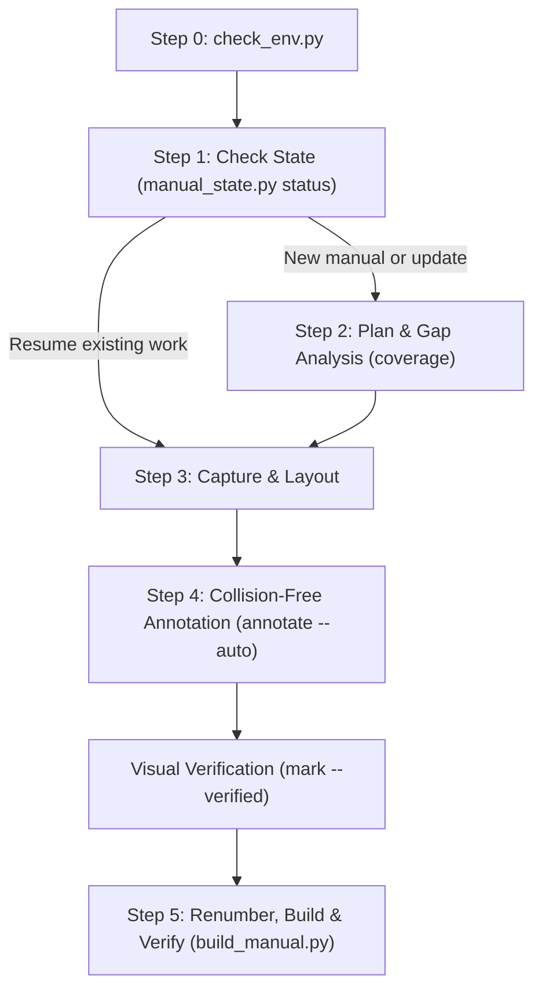

# User Manual Generator Skill

> Generate end-user manual books (user guides / panduan pengguna) for web and desktop applications with working Table of Contents hyperlinks, high-DPI auto-captured screenshots, collision-free arrow annotations, chapter-based figure citations, and page-numbered outputs in Markdown (`.md`) and Microsoft Word (`.docx`).

---

## 📌 Overview

Creating and updating user manuals is traditionally tedious: screenshots quickly become outdated, arrows and badges obscure text labels, Word table-of-contents links break, and page numbers get misaligned whenever new sections are inserted.

The **`user-manual-generator`** skill gives AI coding agents a structured, deterministic toolchain to create, maintain, and update professional user manual books. It features:
- **Sandbox-First Execution**: Works inside standard agent sandboxes with isolated virtual environment support.
- **Task Continuation & Resume**: Tracks milestones in `manual_progress.json` and tells the agent the exact next command to run if interrupted.
- **Feature Gap Analysis**: Compares codebase routes, pages, and menus against the manual to pinpoint missing, documented, or stale features.
- **High-DPI Capture & Layout Mapping**: Automatically captures Retina-grade (`deviceScaleFactor=2`) screenshots and extracts element coordinates into layout sidecars.
- **Collision-Free Arrow Annotations**: Intelligently routes arrows to element boundaries while placing tail badges in clear whitespace without occluding on-screen text.
- **Standards-Compliant Word Output**: Adheres strictly to ECMA-376 OpenXML schema rules, producing clickable Table of Contents hyperlinks, dot leader tabs aligned to printable margins, Roman front-matter numerals, clean blank headers, standard 1.0-inch margins, and dynamic `PAGEREF` page numbers.

---

## 📂 Skill Architecture

```text
skills/user-manual-generator/
├── SKILL.md                          # Core agent instructions and workflow
├── README.md                         # Human-readable documentation
├── references/
│   ├── copywriting-and-layout.md     # Copywriting guidelines, figure captions, and spec schema
│   ├── maintenance-workflow.md       # Task continuation, feature discovery, and renumbering
│   └── security-policy.md            # Security constraints, path validation, and subprocess safety
└── scripts/
    ├── check_env.py                  # Environment readiness and dependency checker
    ├── manual_state.py               # State manager, resume tracker, coverage, and renumbering
    ├── capture_and_annotate.py       # High-DPI capture, grid overlay, and collision-free annotator
    └── build_manual.py               # Two-pass Markdown and OpenXML Word document compiler
```

---

## 🔄 Core Workflow



---

## 🛠️ Requirements & Setup

- **Core Capabilities (Offline / Zero-Dependency)**:
  - **Python 3.9+** (Standard Library) runs Markdown manual generation (`--format md`) and Feature Gap Analysis with zero external packages.
  - Word (`.docx`) manual generation works with either `python-docx` OR automatic headless LibreOffice (`soffice`) fallback.
  - Screenshots can be placed directly in `docs/manual_book/assets/raw/` or captured via Browser MCP tools.
  - All manual assets, specifications, states, and documents reside cleanly in `docs/manual_book/`.
- **Full Suite Setup (When pip & internet are available)**:
  - Python packages: `Pillow`, `python-docx`, `playwright`, `pypdf`
  - Headless browser: Playwright Chromium

```bash
# Verify environment readiness
python3 scripts/check_env.py

# Recommended workspace virtual environment setup (when internet is available)
python3 -m venv .venv-manual
.venv-manual/bin/pip install Pillow python-docx playwright pypdf
PLAYWRIGHT_BROWSERS_PATH=.venv-manual/ms-playwright .venv-manual/bin/python -m playwright install chromium
```

---

## 📄 License

MIT

