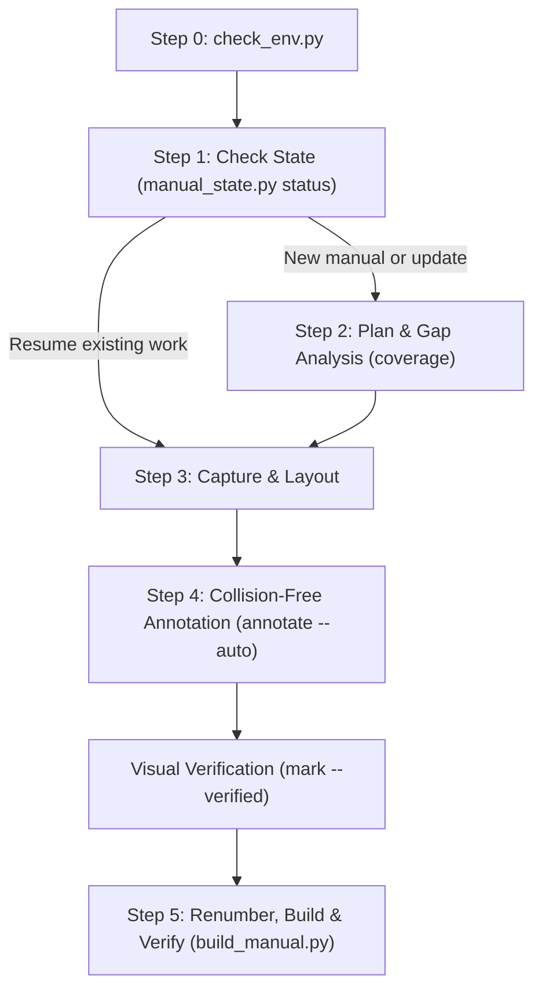

# App Manual Generator

Create clear, high-resolution end-user manual books in Markdown (`.md`), Microsoft Word (`.docx`), and official PDF (`.pdf`) formats. This skill provides sandbox-first execution, task resume support, feature gap analysis, automated high-DPI screenshot capture, layout-aware collision-free arrow annotations (avoiding text occlusion via Pillow or PyCairo), working Table of Contents hyperlinks, self-contained embedded media, and page-numbered outputs.

## When to Use

- The user asks to build or update a manual book, user guide, *buku panduan pengguna*, or visual SOP for a web or desktop application.
- The user wants automated screenshots from a live URL or local dev server (`localhost`) annotated with directional arrows and callout badges that do not occlude on-screen text.
- The deliverable requires structured chapters, working Table of Contents hyperlinks, figure citations (`Figure 1.1` or `Gambar 1.1`), concise bullet-point steps, and accurate page numbers exported to `.md` and `.docx`.
- The user wants to check which application features are already documented versus missing in the existing manual book before adding new sections.

---

## Step 0: Sandbox & Environment Verification

Always check environment readiness using `scripts/check_env.py` before running workflows:

```bash
python3 scripts/check_env.py
```

### Execution & Environment Modes
1. **Sandboxed First**: Run all commands inside Standard Sandbox Mode (`BypassSandbox: false`).
2. **Offline & Zero-Dependency Core**:
   - Compiling Markdown user manuals (`build_manual.py --format md`) and running Gap Analysis (`manual_state.py coverage`) use **100% Python Standard Library**. They run immediately without any internet connection, virtual environments, or `pip` installations.
   - Word (`.docx`) manual generation automatically falls back to headless LibreOffice (`soffice`) if `python-docx` is not installed, and automatically invokes `embed_images.py` to embed media into the `.docx` archive.
   - Image annotations support both **Pillow** and **PyCairo** (`cairo`). If Pillow is missing, PyCairo is used automatically for anti-aliased arrows, badges, and rounded dashed boxes.
   - Web application screenshots can be captured via Browser MCP tools (Playwright MCP / Chrome DevTools) or placed directly into `docs/manual_book/assets/raw/`.
3. **Local Virtual Environment (When pip & internet are available)**:
   If full Playwright auto-capture and Pillow image annotations are desired and an internet connection is available:
   ```bash
   python3 -m venv .venv-manual
   .venv-manual/bin/pip install Pillow python-docx playwright pypdf
   PLAYWRIGHT_BROWSERS_PATH=.venv-manual/ms-playwright .venv-manual/bin/python -m playwright install chromium
   ```
   If network access is restricted or `pip` is unavailable, continue directly using the built-in offline/fallback capabilities (LibreOffice + PyCairo) without blocking.

---

## Core Workflow

Follow this six-step lifecycle to create or maintain a manual book.



---

### Step 1: Check State & Resume Support

Always inspect the current project state before executing any command. If a previous run stopped unexpectedly, `manual_state.py status` detects completed milestones and prints the exact next command:

```bash
python3 scripts/manual_state.py status \
  --spec "docs/manual_book/manual_spec.json" \
  --out-dir "docs/manual_book" \
  --basename "Application_User_Manual"
```

The script determines whether screenshots need capturing, annotations need placing, visual inspection is pending, or outputs need compiling.

---

### Step 2: Plan, Feature Gap Analysis, & Update

#### For New Manuals
1. **Outline Structure**: Draft chapters by user goals (e.g. Chapter 1: Access & Authentication, Chapter 2: Dashboard Navigation, Chapter 3: Data Management).
2. **Non-Technical Language Standard**:
   - **Strictly avoid developer jargon**: Never use terms like API endpoints, JSON payloads, bearer tokens, database records, DOM elements, or frontend/backend architecture in the manual text.
   - **Write for everyday users**: Explain actions from the user's perspective (e.g. clicking buttons, filling fields, selecting menus, and reading on-screen messages). Consult `references/copywriting-and-layout.md` for the jargon replacement table.
3. **Present & Approve Outline**: Present the proposed table of contents and chapter outline directly to the user in chat. Ask for their feedback or confirmation. Only after the user confirms the structure, record approval in the progress tracker:
   ```bash
   python3 scripts/manual_state.py mark \
     --progress "docs/manual_book/manual_progress.json" \
     --phase outline-approved
   ```

#### For Updating Existing Manuals
1. **Import Legacy Manuals**: If an existing manual has no `manual_spec.json`, import its structure from Markdown:
   ```bash
   python3 scripts/manual_state.py import-md \
     --input "legacy_manual.md" \
     --spec-out "docs/manual_book/manual_spec.json"
   ```
2. **Scan Code & Run Gap Analysis**: Inventory application routes and menus (from `routes/`, `pages/`, or navigation bars) into `docs/manual_book/feature_inventory.json` and compare against the manual:
   ```bash
   python3 scripts/manual_state.py coverage \
     --spec "docs/manual_book/manual_spec.json" \
     --inventory "docs/manual_book/feature_inventory.json" \
     --report "docs/manual_book/manual_gap_report.md"
   ```
3. Review covered, missing, and stale features with the user before drafting new sections. Consult `references/maintenance-workflow.md` for framework-specific scanning patterns.

---

### Step 3: High-DPI Screenshot Capture & Layout Mapping

#### Web Applications (Auto-Capture)
Capture Retina-grade screenshots (`deviceScaleFactor=2`) from web URLs (including `http://localhost:3000` or staging environments) and extract text element bounding boxes into `<output>.layout.json`:

```bash
python3 scripts/capture_and_annotate.py capture \
  --url "http://localhost:3000/login" \
  --output "docs/manual_book/assets/raw/login_screen.png" \
  --width 1440 --height 900 \
  --mask-selectors "input[type='password'], .sensitive-token" \
  --target "1=input[type='email']" \
  --target "2=input[type='password']" \
  --target "3=button[type='submit']"
```

- Target selectors save exact UI bounding boxes directly in the layout sidecar.
- Always mask passwords, API keys, and personal data using `--mask-selectors`.

#### Desktop Applications (Existing Raw Screenshots)
For desktop software or pre-captured screenshots:
1. Place the screenshot in `docs/manual_book/assets/raw/<screen_name>.png`.
2. Generate an optional visual coordinate grid helper to inspect pixel locations:
   ```bash
   python3 scripts/capture_and_annotate.py grid \
     --input "docs/manual_book/assets/raw/<screen_name>.png" \
     --output "docs/manual_book/assets/raw/<screen_name>_grid.png"
   ```
3. Pass target element bounding boxes (`x1,y1,x2,y2,label`) to `annotate --auto`:
   ```bash
   python3 scripts/capture_and_annotate.py annotate \
     --auto \
     --input "docs/manual_book/assets/raw/<screen_name>.png" \
     --output "docs/manual_book/assets/final/<screen_name>.png" \
     --target "120,80,320,130,1" \
     --target "120,160,320,210,2"
   ```

#### Precision Coordinate Extraction via Playwright MCP
When interacting with active web applications inside an agent session, use Playwright MCP tools to navigate, extract exact element geometries, and take clean screenshots:

1. **Navigate**: Call `browser_navigate` with the target page URL (e.g. `http://localhost:3000/dashboard`).
2. **Extract Coordinates with `browser_evaluate`**: Run a client-side JavaScript snippet to obtain pixel-accurate bounding rects for buttons, input fields, tables, or modals:
   ```javascript
   () => {
     const selectors = {
       "1": "input[name='email']",
       "2": "input[name='password']",
       "3": "button[type='submit']"
     };
     const results = {};
     for (const [id, sel] of Object.entries(selectors)) {
       const el = document.querySelector(sel);
       if (el) {
         const r = el.getBoundingClientRect();
         results[id] = {
           box: [Math.round(r.left), Math.round(r.top), Math.round(r.width), Math.round(r.height)],
           center: [Math.round(r.left + r.width / 2), Math.round(r.top + r.height / 2)],
           top: [Math.round(r.left + r.width / 2), Math.round(r.top)],
           bottom: [Math.round(r.left + r.width / 2), Math.round(r.bottom)],
           left: [Math.round(r.left), Math.round(r.top + r.height / 2)],
           right: [Math.round(r.right), Math.round(r.top + r.height / 2)]
         };
       }
     }
     return results;
   }
   ```
3. **Capture Screenshot**: Call `browser_take_screenshot` and save the clean image to `docs/manual_book/assets/raw/<screen_name>.png`.
4. **Annotate**: Pass the evaluated coordinates directly to `scripts/annotate_cairo.py` or `scripts/capture_and_annotate.py`.

---

### Step 4: Collision-Free Arrow Annotation & Dual-Engine Support

Never occlude text labels or button captions with arrows. The annotation suite supports two interchangeable engines:
- **Pillow (`PIL`)**: Raster-based drawing with adaptive text obstacle detection.
- **PyCairo (`cairo`)**: Vector-based rendering with gradient/shadowed arrows, high-contrast white outlines, numbered circle badges, and rounded dashed bounding boxes.

#### Running via `capture_and_annotate.py` (Unified CLI)
`capture_and_annotate.py` automatically detects available libraries and defaults to Pillow or PyCairo seamlessly:

```bash
python3 scripts/capture_and_annotate.py annotate \
  --auto \
  --engine auto \
  --grid-snap 10 \
  --input "docs/manual_book/assets/raw/login_screen.png" \
  --output "docs/manual_book/assets/final/login_screen.png"
```

#### Running via `annotate_cairo.py` (Direct PyCairo Engine)
For standalone PyCairo execution or scripting custom batches (like in headless Linux servers without Pillow):

```bash
python3 scripts/annotate_cairo.py \
  --input "docs/manual_book/assets/raw/login_screen.png" \
  --output "docs/manual_book/assets/final/login_screen.png" \
  --box "1040,300,275,38" \
  --arrow "1177,240,1177,296,1"
```

- **Shadow & Glow Styling**: Arrows include a subtle directional shadow (`rgba(0,0,0,0.25)`) and a 1.5px white outline to ensure legibility across dark and light UI themes.
- **Rounded Dashed Bounding Boxes**: Element highlights use a 6px corner radius and `[6.0, 4.0]` dash pattern.
- **Compact Arrow Lengths**: Arrows use compact lengths (45–140 px, favoring the shortest clear distance).
- **Guide Grid Snapping**: The `--grid-snap` flag (default 10 px) aligns arrow tail and badge coordinates to clean grid intersections.
- **Local Grid-Nudge Anti-Collision**: When manual coordinates collide with text or controls, the annotator nudges the arrow along the grid to the nearest clear adjacent whitespace.
- **Visual Verification**: Inspect `docs/manual_book/assets/final/login_screen.png`. Once verified, mark the figure in the progress tracker:
  ```bash
  python3 scripts/manual_state.py mark \
    --progress "docs/manual_book/manual_progress.json" \
    --figure "1.1" --verified
  ```

---

### Step 5: Renumber & Build (.md, .docx, and .pdf)

1. **Renumber Sequence**: If new chapters or sections were added, renumber all figures and in-text citations safely:
   ```bash
   python3 scripts/manual_state.py renumber \
     --spec "docs/manual_book/manual_spec.json"
   ```
2. **Build Outputs**: Compile Markdown, Word documents, and official PDF with working hyperlinks, embedded images, and exact page numbers:
   ```bash
   python3 scripts/build_manual.py \
     --spec "docs/manual_book/manual_spec.json" \
     --out-dir "docs/manual_book" \
     --basename "Application_User_Manual" \
     --format all \
     --export-pdf \
     --page-source auto \
     --verify
   ```

### Output Layout, A4 Paper Standards & Centering Rules
- **A4 Standard Dimensions & Margins**: Word documents are formatted to standard A4 (210mm x 297mm / 8.27" x 11.69") with standard 1.0-inch (2.54 cm / 1440 dxa) margins across all sections, and 0.5-inch (1.27 cm / 720 dxa) header/footer distance. Headers are clean blank whitespace.
- **Image Bounding & Centering**:
  - Images are dynamically scaled to a maximum of 5.8 inches in width and 5.2 inches in height, strictly preventing images from exceeding A4 page borders or pushing captions onto separate pages.
  - **Align Center**: Both the image and the image citation/caption (*Gambar X.Y: Judul* / *Figure X.Y: Title*) are aligned to the center (`align center`) in both Markdown (`<div align="center">`) and Word (`WD_ALIGN_PARAGRAPH.CENTER`) formats.
- **Format Selection & Zero-Crash Fallback**:
  - `--format md`: Generates Markdown only (zero external dependencies).
  - `--format all` / `--format docx`: Uses `python-docx` if installed, or automatically falls back to headless LibreOffice (`soffice`) without crashing if `python-docx` is missing.
  - `--format pdf` / `--export-pdf`: Generates an official publication-ready PDF using sandboxed LibreOffice with isolated temporary profiles (`-env:UserInstallation=file:///tmp/lo_prof_*`).
- **DOCX Media Auto-Embedding (`embed_images.py`)**:
  - When compiling DOCX via LibreOffice fallback, `build_manual.py` automatically executes `embed_images.py`.
  - Converts external relationship links (`r:link` with `TargetMode="External"`) into internal embedded media (`r:embed` inside `word/media/`), producing 100% self-contained Word archives that display images reliably when transferred across computers.
  - Automatically constrains image dimensions (`<wp:extent>` and `<a:ext>`) proportionally so they never exceed A4 margin boundaries (5.8 inches wide, 5.2 inches high).
- **Cover Page (1 Full Page)**: Contains the title, subtitle, version, update date, and a prominent logo placeholder (`[ LOGO APLIKASI ]` or custom `"logo_path"`). Has no page number footer and ends with a strict page break.
- **Table of Contents (Page 2)**: Numbered with lowercase Roman numerals (`i`, `ii`...). List of Figures (Daftar Gambar) is omitted. Followed by a strict page break so Chapter 1 begins on a brand new page.
- **Main Chapters (Page 3+: 1..N)**: Chapter 1 begins on a fresh page immediately after the Table of Contents. Each subsequent Chapter begins on a new page.
- **Justified Text Alignment**: All narrative body paragraphs and step-by-step bullet points are formatted as justified (rata kiri-kanan) in Markdown, Word, and PDF.
- **True Bold Formatting**: Bold text wrapped in `**text**` is converted to native bold runs in Word and PDF without leaving raw asterisks.
- **Markdown (`.md`)**: TOC uses pure clickable anchor links without page numbers. Footers display `*X*`.
- **Word (`.docx`)**: Every entry in Table of Contents contains a clickable hyperlink, right-aligned dot leader tab aligned to the printable margin boundary (9029 dxa / 6.27 inches for A4), and dynamic `PAGEREF` fields. Footers display `*X*` right-aligned.
- **Official PDF (`.pdf`)**: Converted directly from `.docx` via headless LibreOffice with internal bookmarks and table of contents preserved.
- **Non-Destructive Archiving**: Previous outputs are automatically archived to `docs/manual_book/archive/<basename>_<timestamp>/` before rebuilding.

### Standard Directory Structure (`docs/manual_book/`)

All manual book inputs, states, raw media, and deliverables live cleanly in `docs/manual_book/`:

```text
docs/manual_book/
├── assets/                          # Media assets
│   ├── raw/                         # Raw screenshots & logo placeholder
│   └── final/                       # Final annotated screenshots
├── archive/                         # Non-destructive historical backups
│   └── <basename>_<timestamp>/
├── manual_spec.json                 # Manual structure, chapters, and figure specs
├── manual_progress.json             # Progress milestones and visual verification log
├── feature_inventory.json           # Scanned application routes and features
├── manual_gap_report.md             # Feature gap analysis report
├── <Basename>.md                    # Compiled Markdown user guide
├── <Basename>.docx                  # Compiled Word user guide with embedded images
└── <Basename>.pdf                   # Publication-ready official PDF
```

---

## Security & Safety Guardrails

Always follow the security rules in `references/security-policy.md`:
- **Workspace Path Containment**: Scripts reject any path escaping the active project root (`os.getcwd()`) via `os.path.realpath`, keeping all operations strictly within the repository. All manual book assets and data files are stored inside `docs/manual_book/`.
- **Standard Web Protocols & Localhost**: Browser navigation supports standard `http://` and `https://` URLs, with full first-class support for `localhost` dev servers (`http://localhost:3000`, `http://127.0.0.1:8080`). Non-web schemes (`file://`, `javascript:`) are rejected.
- **Subprocess Safety**: LibreOffice conversion runs headless with isolated temporary profiles (`-env:UserInstallation=file:///tmp/lo_prof_*`), explicit argument separators (`--`), and timeouts.
- **Safe Virtual Environments**: Use standard `python3 -m venv .venv-manual`. Never execute remote setup scripts downloaded from the web.

---

## Reference Documents

| Document | Purpose | When to Consult |
|---|---|---|
| [`references/copywriting-and-layout.md`](references/copywriting-and-layout.md) | Copywriting standards, figure captions, citation format, and JSON schema | When drafting chapter bodies, figure captions, or `manual_spec.json` content |
| [`references/maintenance-workflow.md`](references/maintenance-workflow.md) | Feature discovery, route scanning patterns, legacy import, and non-destructive updates | When updating existing manuals or scanning framework route definitions |
| [`references/security-policy.md`](references/security-policy.md) | Security constraints, path verification, and subprocess rules | When validating system safety and sandbox constraints |
