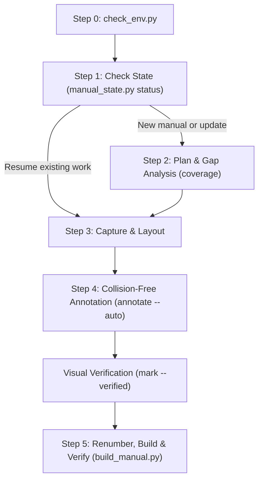

# User Manual Generator

Create clear, high-resolution end-user manual books in Markdown (`.md`), Microsoft Word (`.docx`), and official PDF (`.pdf`) formats. This skill provides sandbox-first execution, task resume support, feature gap analysis, automated high-DPI screenshot capture, layout-aware collision-free arrow annotations (avoiding text occlusion via Pillow or PyCairo), working Table of Contents hyperlinks, self-contained embedded media, and page-numbered outputs.

## When to Use

- The user asks to build or update a manual book, user guide, *buku panduan pengguna*, or visual SOP for a web or desktop application.
- The user wants automated screenshots from a live URL or local dev server (`localhost`) annotated with directional arrows and callout badges that do not occlude on-screen text.
- The deliverable requires structured chapters, working Table of Contents hyperlinks, figure citations (`Figure 1.1` or `Gambar 1.1`), concise bullet-point steps, and accurate page numbers exported to `.md` and `.docx`.
- The user wants to check which application features are already documented versus missing in the existing manual book before adding new sections.

---

## Step 0: Sandbox & Environment Verification

Always check environment readiness using `scripts/check_env.py` before running workflows:

```bash
python3 scripts/check_env.py
```

### Execution & Environment Modes
1. **Sandboxed First**: Run all commands inside Standard Sandbox Mode (`BypassSandbox: false`).
2. **Offline & Zero-Dependency Core**:
   - Compiling Markdown (`.md`), multi-section Word (`.docx` via `build_docx_stdlib_oxml`), and running Gap Analysis (`manual_state.py coverage`) use **100% Python Standard Library**. They run immediately without any internet connection, virtual environments, or `pip` installations.
   - When headless LibreOffice (`soffice`) and either `pypdf` or `pdftotext` are available, `build_manual.py` runs a full 2-pass PDF compilation to populate exact section page numbers in the `.docx` Table of Contents alongside dynamic `PAGEREF` fields.
   - Image annotations support both **Pillow** and **PyCairo** (`cairo`), both equipped with automatic pixel-contrast text obstacle detection so badges and arrows avoid UI text even without a `.layout.json` sidecar.
   - Web application screenshots can be captured via Browser MCP tools (Playwright MCP / Chrome DevTools) or placed directly into `docs/manual_book/assets/raw/`.
3. **Local Virtual Environment (When pip & internet are available)**:
   If full Playwright auto-capture and Pillow image annotations are desired and an internet connection is available:
   ```bash
   python3 -m venv .venv-manual
   .venv-manual/bin/pip install Pillow playwright pypdf
   PLAYWRIGHT_BROWSERS_PATH=.venv-manual/ms-playwright .venv-manual/bin/python -m playwright install chromium
   ```
   If network access is restricted or `pip` is unavailable, continue directly using the built-in offline/fallback capabilities (LibreOffice + PyCairo) without blocking.

---

## Core Workflow

Copy and track progress using this checklist:

```markdown
- [ ] Step 0: Verify environment readiness (scripts/check_env.py)
- [ ] Step 1: Check project state or resume point (scripts/manual_state.py status)
- [ ] Step 2: Plan chapter outline or run feature gap analysis (scripts/manual_state.py coverage)
- [ ] Step 3: Capture high-DPI screenshots and layout maps (scripts/capture_and_annotate.py capture)
- [ ] Step 4: Annotate screenshots and visually verify (scripts/capture_and_annotate.py annotate --auto)
- [ ] Step 5: Renumber citations, compile outputs, and verify (scripts/build_manual.py --verify)
```



---

### Step 1: Check State & Resume Support

Always inspect the current project state before executing any command. If a previous run stopped unexpectedly, `manual_state.py status` detects completed milestones and prints the exact next command:

```bash
python3 scripts/manual_state.py status \
  --spec "docs/manual_book/manual_spec.json" \
  --out-dir "docs/manual_book" \
  --basename "Application_User_Manual"
```

The script determines whether screenshots need capturing, annotations need placing, visual inspection is pending, or outputs need compiling.

---

### Step 2: Plan, Feature Gap Analysis, & Update

#### For New Manuals
1. **Outline Structure**: Draft chapters by user goals (e.g. Chapter 1: Access & Authentication, Chapter 2: Dashboard Navigation, Chapter 3: Data Management).
2. **Non-Technical Language Standard**:
   - **Strictly avoid developer jargon**: Never use terms like API endpoints, JSON payloads, bearer tokens, database records, DOM elements, or frontend/backend architecture in the manual text.
   - **Write for everyday users**: Explain actions from the user's perspective (e.g. clicking buttons, filling fields, selecting menus, and reading on-screen messages). Consult `references/copywriting-and-layout.md` for the jargon replacement table.
3. **Present & Approve Outline**: Present the proposed table of contents and chapter outline directly to the user in chat. Ask for their feedback or confirmation. Only after the user confirms the structure, record approval in the progress tracker:
   ```bash
   python3 scripts/manual_state.py mark \
     --progress "docs/manual_book/manual_progress.json" \
     --phase outline-approved
   ```

#### For Updating Existing Manuals
1. **Import Legacy Manuals**: If an existing manual has no `manual_spec.json`, import its structure from Markdown:
   ```bash
   python3 scripts/manual_state.py import-md \
     --input "legacy_manual.md" \
     --spec-out "docs/manual_book/manual_spec.json"
   ```
2. **Scan Code & Run Gap Analysis**: Inventory application routes and menus (from `routes/`, `pages/`, or navigation bars) into `docs/manual_book/feature_inventory.json` and compare against the manual:
   ```bash
   python3 scripts/manual_state.py coverage \
     --spec "docs/manual_book/manual_spec.json" \
     --inventory "docs/manual_book/feature_inventory.json" \
     --report "docs/manual_book/manual_gap_report.md"
   ```
3. Review covered, missing, and stale features with the user before drafting new sections. Consult `references/maintenance-workflow.md` for framework-specific scanning patterns.

---

### Step 3: High-DPI Screenshot Capture & Layout Mapping

#### Web Applications (Auto-Capture)
Capture Retina-grade screenshots (`deviceScaleFactor=2`) from web URLs (including `http://localhost:3000` or staging environments) and extract text element bounding boxes into `<output>.layout.json`:

```bash
python3 scripts/capture_and_annotate.py capture \
  --url "http://localhost:3000/login" \
  --output "docs/manual_book/assets/raw/login_screen.png" \
  --width 1440 --height 900 \
  --mask-selectors "input[type='password'], .sensitive-token" \
  --target "1=input[type='email']" \
  --target "2=input[type='password']" \
  --target "3=button[type='submit']"
```

- Target selectors save exact UI bounding boxes directly in the layout sidecar.
- Always mask passwords, API keys, and personal data using `--mask-selectors`.
- **Batch Mode from `manual_spec.json`**: Reuse a single browser session and annotate all pending figures in one pass using `batch --spec` (or `capture --spec` / `annotate --auto --spec`):
  ```bash
  python3 scripts/capture_and_annotate.py batch \
    --spec "docs/manual_book/manual_spec.json" \
    --draw-target-boxes
  ```

#### Desktop Applications (Existing Raw Screenshots)
For desktop software or pre-captured screenshots:
1. Place the screenshot in `docs/manual_book/assets/raw/<screen_name>.png`.
2. Generate an optional visual coordinate grid helper to inspect pixel locations:
   ```bash
   python3 scripts/capture_and_annotate.py grid \
     --input "docs/manual_book/assets/raw/<screen_name>.png" \
     --output "docs/manual_book/assets/raw/<screen_name>_grid.png"
   ```
3. Pass target element bounding boxes (`x1,y1,x2,y2,label`) to `annotate --auto`:
   ```bash
   python3 scripts/capture_and_annotate.py annotate \
     --auto \
     --input "docs/manual_book/assets/raw/<screen_name>.png" \
     --output "docs/manual_book/assets/final/<screen_name>.png" \
     --target "120,80,320,130,1" \
     --target "120,160,320,210,2"
   ```

#### Precision Coordinate Extraction via Playwright MCP
When interacting with active web applications inside an agent session, use Playwright MCP tools to navigate, lock scroll position, extract exact text & target geometries into `<screen_name>.layout.json`, and capture clean screenshots:

1. **Navigate**: Call `browser_navigate` with the target page URL (e.g. `http://localhost:3000/dashboard`).
2. **Lock Scroll & Extract Layout Sidecar with `browser_evaluate`**: Keep the exact same scroll position (`window.scrollTo(0, 0)`) before evaluating and before `browser_take_screenshot` so bounding boxes never drift vertically. Save the returned JSON object to `docs/manual_book/assets/raw/<screen_name>.layout.json`:
   ```javascript
   () => {
     window.scrollTo(0, 0);
     const scale = window.devicePixelRatio || 1;
     const selectors = [
       ["1", "input[name='email']"],
       ["2", "input[name='password']"],
       ["3", "button[type='submit']"]
     ];
     const text_rects = [];
     const walker = document.createTreeWalker(document.body, NodeFilter.SHOW_TEXT);
     while (walker.nextNode()) {
       const node = walker.currentNode;
       if (!node.textContent || !node.textContent.trim()) continue;
       const el = node.parentElement;
       if (!el) continue;
       const st = window.getComputedStyle(el);
       if (st.display === "none" || st.visibility === "hidden" || st.opacity === "0") continue;
       const range = document.createRange();
       range.selectNodeContents(node);
       for (const r of range.getClientRects()) {
         if (r.width > 2 && r.height > 2) {
           text_rects.push({
             x1: Math.round(r.left * scale), y1: Math.round(r.top * scale),
             x2: Math.round(r.right * scale), y2: Math.round(r.bottom * scale),
             text: node.textContent.trim().slice(0, 30)
           });
         }
       }
     }
     const target_boxes = [];
     for (const [label, selector] of selectors) {
       const el = document.querySelector(selector);
       if (!el) continue;
       const r = el.getBoundingClientRect();
       target_boxes.push({
         label, selector,
         x1: Math.round(r.left * scale), y1: Math.round(r.top * scale),
         x2: Math.round(r.right * scale), y2: Math.round(r.bottom * scale)
       });
     }
     return { scale, text_rects, target_boxes };
   }
   ```
3. **Capture Screenshot**: Without scrolling, call `browser_take_screenshot` and save the clean image to `docs/manual_book/assets/raw/<screen_name>.png`. Verify whether the saved PNG dimensions match CSS viewport (`scale = 1`) or physical pixels (`scale = devicePixelRatio`), and adjust `scale` accordingly if needed.
4. **Annotate**: Run `scripts/capture_and_annotate.py annotate --auto --draw-target-boxes` (which automatically reads `<screen_name>.layout.json`), or pass `--box-coords` (`x1,y1,x2,y2`) / `--box` (`x,y,w,h`) to `scripts/annotate_cairo.py`.

---

### Step 4: Collision-Free Arrow Annotation & Dual-Engine Support

Never occlude text labels, headings, or button captions with arrows or dashed boxes. Both engines automatically detect pixel-contrast text obstacles when `.layout.json` is absent:
- **Pillow (`PIL`)**: Raster-based drawing with adaptive text obstacle detection.
- **PyCairo (`cairo`)**: Vector-based rendering with shadowed arrows, high-contrast white outlines, numbered circle badges, and rounded dashed bounding boxes.

#### Running via `capture_and_annotate.py` (Unified CLI)
`capture_and_annotate.py` automatically detects available libraries and defaults to Pillow or PyCairo seamlessly (`--box` always takes `x1,y1,x2,y2`; use `--box-xywh` for `x,y,w,h`):

```bash
python3 scripts/capture_and_annotate.py annotate \
  --auto \
  --draw-target-boxes \
  --engine auto \
  --grid-snap 10 \
  --input "docs/manual_book/assets/raw/login_screen.png" \
  --output "docs/manual_book/assets/final/login_screen.png"
```

#### Running via `annotate_cairo.py` (Direct PyCairo Engine)
For standalone PyCairo execution (`--box` takes `x,y,w,h`; `--box-coords` takes `x1,y1,x2,y2`):

```bash
python3 scripts/annotate_cairo.py \
  --input "docs/manual_book/assets/raw/login_screen.png" \
  --output "docs/manual_book/assets/final/login_screen.png" \
  --box "1040,300,275,38" \
  --arrow "1177,240,1177,296,1"
```

- **Mandatory Visual Inspection Before `--verified`**: Open and inspect **every** annotated image one by one (e.g. via `read_file` or an image viewer) to verify: (1) zero badges, arrowheads, or dashed lines cover headings/labels, (2) dashed boxes frame the target cleanly without slicing adjacent text, and (3) badge numbers flow logically top-to-bottom. Never batch-mark figures without inspecting each output first. After inspecting multiple figures, you may record them together in one call (`--figure "1.1,1.2"` or `--all-figures`); `manual_state.py mark --verified` checks every `<image>.arrows.json` and rejects figures with `unresolved_collisions > 0`:
  ```bash
  python3 scripts/manual_state.py mark \
    --progress "docs/manual_book/manual_progress.json" \
    --spec "docs/manual_book/manual_spec.json" \
    --figure "1.1,1.2" --verified
  ```

---

### Step 5: Renumber & Build (.md, .docx, and .pdf)

1. **Renumber Sequence**: If new chapters or sections were added, renumber all figures and in-text citations safely:
   ```bash
   python3 scripts/manual_state.py renumber \
     --spec "docs/manual_book/manual_spec.json"
   ```
2. **Build Outputs**: Compile Markdown, Word documents, and official PDF with working hyperlinks, embedded images, and exact page numbers:
   ```bash
   python3 scripts/build_manual.py \
     --spec "docs/manual_book/manual_spec.json" \
     --out-dir "docs/manual_book" \
     --basename "Application_User_Manual" \
     --format all \
     --export-pdf \
     --page-source auto \
     --verify
   ```

### Output Layout, A4 Paper Standards & Centering Rules
- **A4 Standard Dimensions & Margins**: Word documents are formatted to standard A4 (210mm x 297mm / 8.27" x 11.69" / `11906 x 16838 dxa`) with 1.0-inch (`1440 dxa`) margins across all 3 sections and 0.5-inch (`720 dxa`) header/footer distance.
- **Image Bounding, Framing & Anti-Orphan Pagination**:
  - Chapter screenshots are scaled proportionally (up to 6.0" wide x 4.0" high in DOCX; up to 5.0" high for portrait screenshots via `portrait_max_h`) with a subtle `#CBD5E1` border so white UI cards stand out cleanly and headings + screenshot + caption + bullet points fit together without orphaned trailing lines.
  - Both the image and the figure caption (**Gambar X.Y:** Judul / **Figure X.Y:** Title, 9.5pt) are center-aligned with `keepNext` chains linking section headings, images, captions, and bullets.
- **Format Selection & Native OpenXML Builder**:
  - `--format md`: Generates Markdown only (zero external dependencies).
  - `--format all` / `--format docx`: Always builds a native multi-section ECMA-376 OpenXML `.docx` (`build_docx_stdlib_oxml`) using 100% Python stdlib with embedded `word/media/` images, multi-paragraph `\n\n` breaks, and styled callout blockquotes (`> **Note:** ...`).
  - `--format pdf` / `--export-pdf`: Renders an official PDF via sandboxed headless LibreOffice (`-env:UserInstallation=file:///tmp/lo_prof_*`), using `pypdf` named destinations or `pdftotext` in Pass 2 to populate exact section page numbers in the TOC (reusing the Pass 2 PDF without re-running LibreOffice when TOC page numbers are unchanged).
- **3-Section Pagination Hierarchy**:
  - **Cover Page (Section 1)**: Centered logo or `[ APPLICATION LOGO ]` / `[ LOGO APLIKASI ]` box, wrapped 26pt bold title, subtitle, metadata rule, and **no page number**.
  - **Table of Contents (Section 2)**: Lowercase Roman numerals (`i`, `ii`...), clickable internal hyperlinks, right-aligned dot leaders at `9026 dxa` (6.27"), `360 dxa` subsection indentation, and `PAGEREF` fields.
  - **Main Chapters (Section 3)**: Arabic numerals starting at `1`, chapter page breaks, configurable `text_align` (`justify` default, `left` optional), `Arial`/`Courier New` default typography (`font_family`/`code_font_family` optional), 11pt body/bullets, and native bold/italic/code runs.
- **Non-Destructive Archiving**: Previous outputs are automatically archived to `<out_dir>/archive/<basename>_<timestamp>/` before rebuilding.

### Standard Directory Structure (`docs/manual_book/`)

All manual book inputs, states, raw media, and deliverables live cleanly in `docs/manual_book/`:

```text
docs/manual_book/
├── assets/                          # Media assets
│   ├── raw/                         # Raw screenshots & logo placeholder
│   └── final/                       # Final annotated screenshots
├── archive/                         # Non-destructive historical backups
│   └── <basename>_<timestamp>/
├── manual_spec.json                 # Manual structure, chapters, and figure specs
├── manual_progress.json             # Progress milestones and visual verification log
├── feature_inventory.json           # Scanned application routes and features
├── manual_gap_report.md             # Feature gap analysis report
├── <Basename>.md                    # Compiled Markdown user guide
├── <Basename>.docx                  # Compiled Word user guide with embedded images
└── <Basename>.pdf                   # Publication-ready official PDF
```

---

## Security & Safety Guardrails

Always follow the security rules in `references/security-policy.md`:
- **Workspace Path Containment**: Scripts reject any path escaping the active project root (`os.getcwd()`) via `os.path.realpath`, keeping all operations strictly within the repository. All manual book assets and data files are stored inside `docs/manual_book/`.
- **Standard Web Protocols & Localhost**: Browser navigation supports standard `http://` and `https://` URLs, with full first-class support for `localhost` dev servers (`http://localhost:3000`, `http://127.0.0.1:8080`). Non-web schemes (`file://`, `javascript:`) are rejected.
- **Subprocess Safety**: LibreOffice conversion runs headless with isolated temporary profiles (`-env:UserInstallation=file:///tmp/lo_prof_*`), explicit argument separators (`--`), and timeouts.
- **Safe Virtual Environments**: Use standard `python3 -m venv .venv-manual`. Never execute remote setup scripts downloaded from the web.

---

## Reference Documents

| Document | Purpose | When to Consult |
|---|---|---|
| [`references/copywriting-and-layout.md`](references/copywriting-and-layout.md) | Copywriting standards, figure captions, citation format, and JSON schema | When drafting chapter bodies, figure captions, or `manual_spec.json` content |
| [`references/maintenance-workflow.md`](references/maintenance-workflow.md) | Feature discovery, route scanning patterns, legacy import, and non-destructive updates | When updating existing manuals or scanning framework route definitions |
| [`references/security-policy.md`](references/security-policy.md) | Security constraints, path verification, and subprocess rules | When validating system safety and sandbox constraints |
